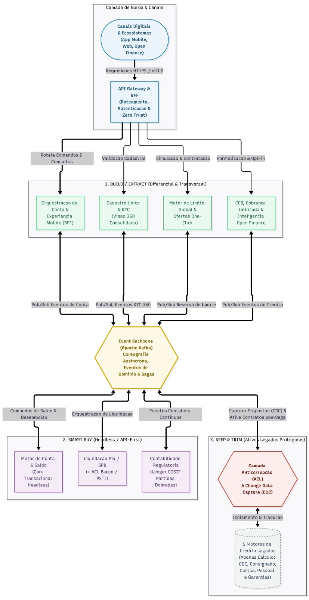
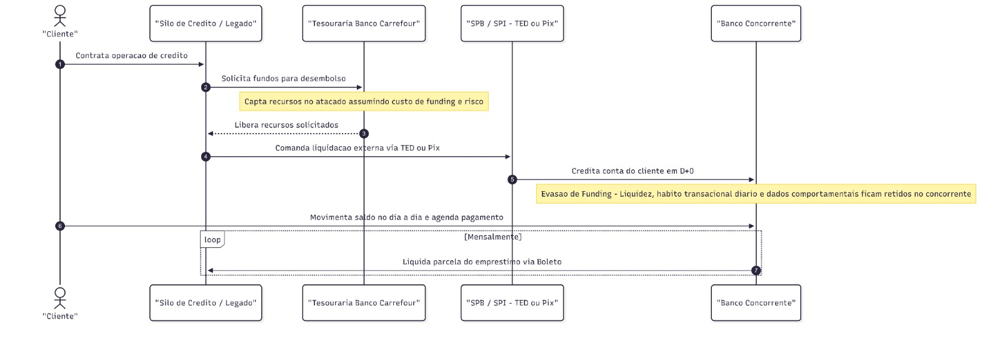
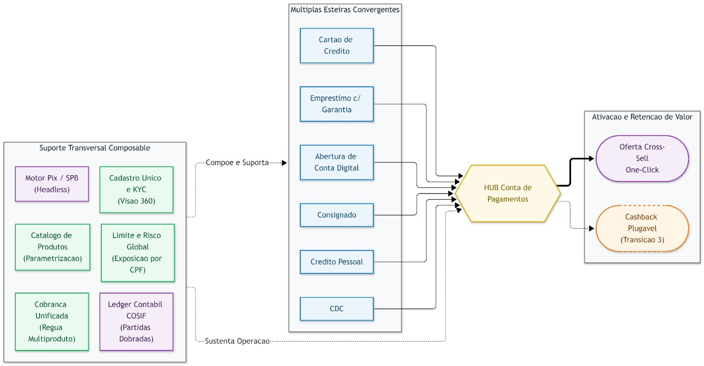
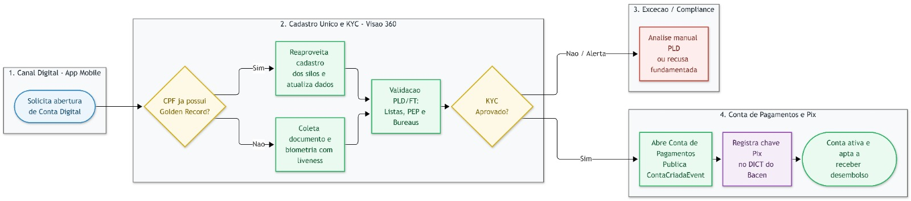
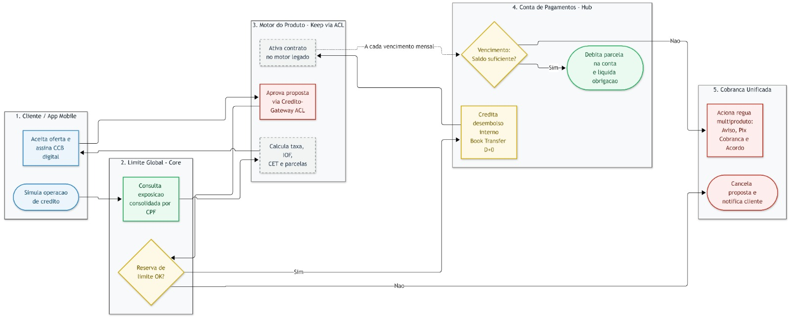
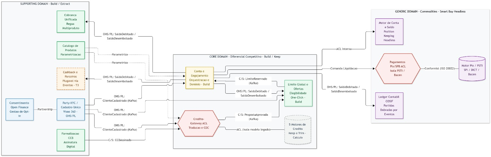
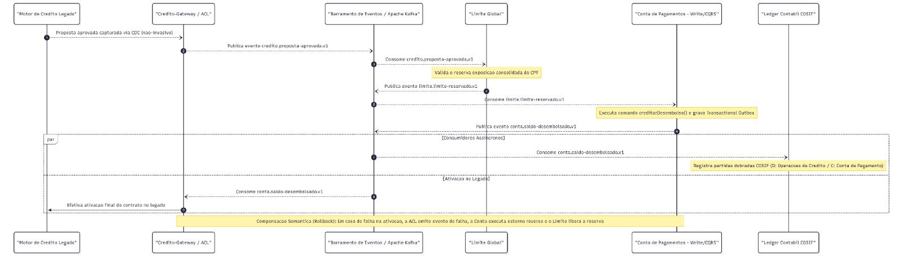
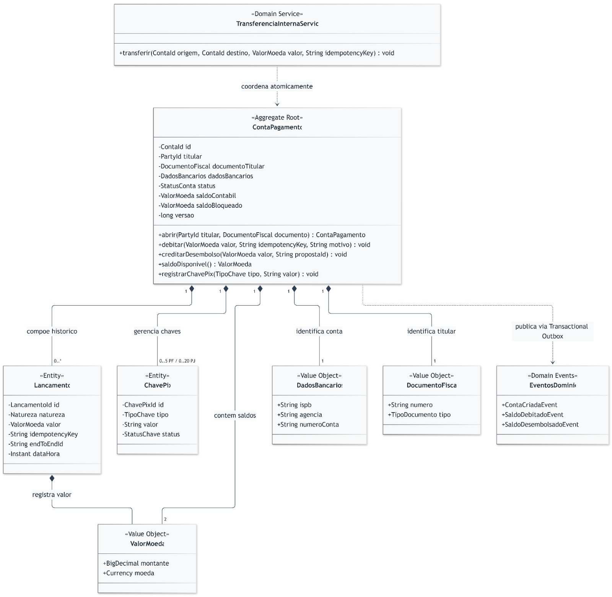
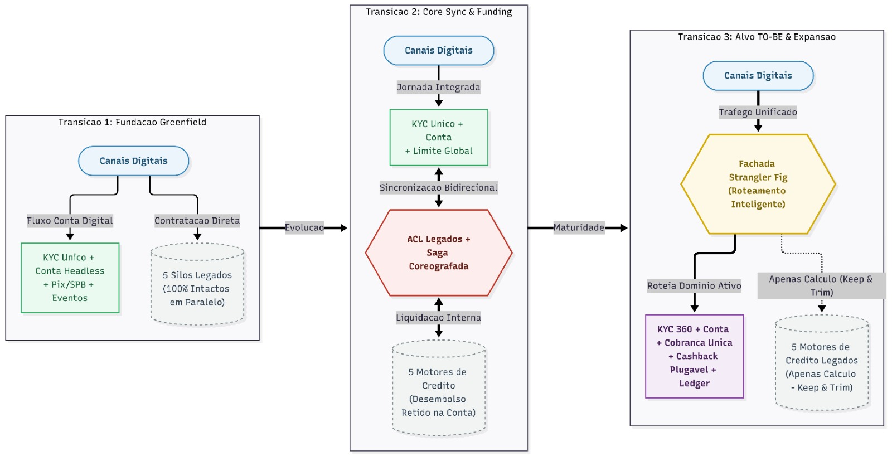

# Desafio Arquiteto Corporativo — Banco Carrefour
## Visão de Arquitetura: Conta de Pagamentos, Composable Banking e Plano de Transição

[](#14-rastreabilidade-togaf-adm)
[](#5-arquitetura-alvo-sistemas-e-tecnologia)
[](#45-requisitos-e-classificação)

Visão de Arquitetura elaborada pelo time de Enterprise Architecture para apoiar a decisão do C-level do **Banco Carrefour**. As referências usadas são **TOGAF ADM**, a taxonomia bancária **BIAN**, **Domain-Driven Design** (estratégico e tático) e a estratégia de sourcing **Composable Banking**. O estilo arquitetural vigente, **Microservices**, é preservado.

---

## Resumo Executivo

O banco tem um portfólio concentrado em crédito (CDC, Consignado, Cartão, Crédito Pessoal e Empréstimo com Garantia), construído em **silos sem reaproveitamento**. O relacionamento com o cliente é **episódico**: ele contrata, recebe o dinheiro em outro banco e só volta para pagar parcelas. Os pilotos de **Conta de Pagamentos** e **Cashback** foram bem-sucedidos, e o C-level quer priorizar apenas um deles. O CTO questiona se não seria melhor comprar um Core Bancário.

| Pergunta do C-level | Recomendação de EA | Lastro |
| :--- | :--- | :--- |
| **Conta de Pagamentos ou Cashback?** | **Conta de Pagamentos agora.** O Cashback vira um módulo plugável sobre os eventos da conta, na Transição 3. | [ADR-001](#adr-001-priorizar-a-conta-de-pagamentos) |
| **Comprar um Core Bancário?** | **Não** um core monolítico "all-in-one". **Sim** para componentes de core *headless* (conta/saldo, Pix, ledger), compostos com o que já é aderente. | [ADR-002](#adr-002-composable-banking-em-vez-de-core-monolítico) |
| **Como migrar sem ruptura?** | Três arquiteturas de transição usando Camadas Anticorrupção (ACL), eventos (Kafka), Saga e Strangler Fig. | [ADR-003](#adr-003-integração-por-acl-eventos-e-transição-incremental) |
| **Como acelerar novos produtos?** | Capacidades transversais reutilizáveis (Cadastro Único, Conta, Limite Global, Cobrança, Catálogo de Produtos) expostas por APIs e eventos. O próprio Cashback serve de prova: entra sem alterar a conta. | [§4.1](#41-mapa-de-capacidades-top-level-bian) · [§5](#5-arquitetura-alvo-sistemas-e-tecnologia) |

**Por que a Conta:** é o único dos dois produtos que gera **uso diário** (Pix, salário, pagamentos). Ela obriga a criação de capacidades reutilizáveis (cadastro e KYC únicos, trilho de pagamentos, ledger, eventos) e se conecta ao portfólio de crédito existente. Com ela, o dinheiro do crédito passa a cair na própria instituição (*book transfer*) e as parcelas passam a ser debitadas na conta. O Cashback **depende** de uma conta para creditar o benefício; a Conta não depende do Cashback.

**KPIs da visão:** DAU/MAU e transações por cliente por mês (engajamento) · % de desembolsos liquidados internamente · custo de KYC por cliente e nº de cadastros por CPF (meta = 1) · *lead time* de lançamento de novos produtos.



*Figura 1: Arquitetura macro TO-BE — Build, Smart Buy Headless e Keep & Trim integrados pelo barramento de eventos.*

---

<details>
<summary><b>📑 Sumário</b></summary>

- [Resumo Executivo](#resumo-executivo)
- [1. Contexto, Premissas e Abordagem](#1-contexto-premissas-e-abordagem)
  - [1.1 Stakeholders e Preocupações](#11-stakeholders-e-preocupações) · [1.2 Premissas Adotadas](#12-premissas-adotadas) · [1.3 Por Que Estes Frameworks](#13-por-que-estes-frameworks) · [1.4 Rastreabilidade TOGAF ADM](#14-rastreabilidade-togaf-adm) · [1.5 Princípios de Arquitetura](#15-princípios-de-arquitetura)
- [2. Situação Atual (AS-IS)](#2-situação-atual-as-is)
  - [2.1 Mapa de Problemas de Negócio](#21-mapa-de-problemas-de-negócio) · [2.2 Subdomínios (DDD Estratégico)](#22-subdomínios-ddd-estratégico) · [2.3 Fluxo e Cadeia de Valor AS-IS](#23-fluxo-e-cadeia-de-valor-as-is)
- [3. Recomendações da Visão de Arquitetura](#3-recomendações-da-visão-de-arquitetura)
  - [3.1 Qual Produto Habilitar](#31-qual-produto-habilitar-conta-de-pagamentos) · [3.2 Adquirir um Core Bancário?](#32-adquirir-um-core-bancário)
- [4. Arquitetura de Negócio e Capacidades](#4-arquitetura-de-negócio-e-capacidades)
  - [4.1 Mapa de Capacidades](#41-mapa-de-capacidades-top-level-bian) · [4.2 Cadeia de Valor TO-BE](#42-cadeia-de-valor-to-be) · [4.3 Fluxos de Valor e Interoperabilidade](#43-fluxos-de-valor-to-be-e-interoperabilidade) · [4.4 Processos de Negócio](#44-processos-de-negócio) · [4.5 Requisitos](#45-requisitos-e-classificação) · [4.6 Funcionalidades Emergentes](#46-funcionalidades-emergentes)
- [5. Arquitetura Alvo (Sistemas e Tecnologia)](#5-arquitetura-alvo-sistemas-e-tecnologia)
  - [5.1 Estilos Arquiteturais](#51-estilos-arquiteturais) · [5.2 Padrões de Decomposição](#52-padrões-de-decomposição-de-microsserviços) · [5.3 Context Map](#53-context-map) · [5.4 Catálogo de Microsserviços](#54-catálogo-de-microsserviços) · [5.5 Saga e CQRS](#55-saga-de-desembolso-e-cqrs) · [5.6 Building Blocks](#56-building-blocks-abb-e-sbb) · [5.7 DDD Tático](#57-ddd-tático-agregado-contapagamento)
- [6. Plano de Migração](#6-plano-de-migração)
  - [6.1 Gap Analysis](#61-gap-analysis) · [6.2 Arquiteturas de Transição](#62-arquiteturas-de-transição) · [6.3 Strangler Fig](#63-decomposição-por-strangler-fig) · [6.4 Riscos](#64-riscos-da-transição) · [6.5 Governança](#65-governança-da-implementação)
- [7. Registros de Decisão (ADRs)](#7-registros-de-decisão-adrs)

</details>

---

## 1. Contexto, Premissas e Abordagem

### 1.1 Stakeholders e Preocupações

| Stakeholder | Preocupação principal | Como a visão responde |
| :--- | :--- | :--- |
| **C-level / CEO** | Aumentar portfólio e engajamento priorizando **um** produto | Matriz de decisão e KPIs de engajamento |
| **CTO** | Acelerar lançamentos; avaliar a compra de um Core Bancário | Composable Banking e alternativas avaliadas |
| **CIO** | Decisão lastreada e sem risco operacional | ADRs e transição incremental |
| **Tesouraria / CFO** | Custo de captação | Liquidação interna do crédito (P-01) e enquadramento da conta  |
| **Compliance / Jurídico** | Conformidade Bacen, PLD/FT, LGPD | Requisitos regulatórios RR-01 a RR-07 |
| **Gestores dos produtos de crédito** | Não interromper as esteiras que faturam hoje | Keep & Trim e ACL ([ADR-003](#adr-003-integração-por-acl-eventos-e-transição-incremental)) |
| **Cliente** | Experiência única, sem recadastro | Onboarding único e One-Click |

### 1.2 Premissas Adotadas

O case é genérico. As premissas abaixo foram adotadas pelo time de EA e devem ser validadas com o negócio.

| ID | Premissa |
| :---: | :--- |
| **PR-01** | O banco não oferece hoje conta transacional própria. Os desembolsos de crédito são liquidados via TED/Pix em contas de outras instituições. |
| **PR-02** | Os **motores de cálculo** dos 5 produtos (Price/SAC, IOF, CET, margem consignável, LTV, rotativo) são maduros e auditados. A ineficiência está nas esteiras periféricas: cadastro, cobrança e liquidação. |
| **PR-03** | Os sistemas legados expõem dados por bancos relacionais, o que viabiliza *Change Data Capture*, mas não necessariamente por APIs. |
| **PR-04** | O banco é instituição financeira autorizada e pode oferecer conta de pagamento e/ou conta de depósito à vista. |
| **PR-05** | **Microservices é uma restrição** (definida no case), não uma opção a ser reavaliada. |

### 1.3 Por Que Estes Frameworks

| Referência | Para que foi usada | Por que esta (e não outra) |
| :--- | :--- | :--- |
| **TOGAF ADM** | Conduzir da Visão de Arquitetura até o plano de migração | O case pede Visão de Arquitetura, TO-BE e plano de migração, que é exatamente o ciclo do ADM. Zachman, por exemplo, é uma taxonomia sem método de transição. |
| **BIAN** | Nomear e classificar capacidades e *service domains* | É o vocabulário canônico da indústria bancária. Evita um mapa de capacidades "inventado" e facilita a análise de aderência (*fit-gap*) com fornecedores *headless*, que mapeiam suas APIs ao BIAN. |
| **DDD Estratégico** | Subdomínios (Core/Supporting/Generic) e bounded contexts | Liga o **problema de negócio** à **fronteira do microsserviço** e sustenta a decisão de construir ou comprar: constrói-se o Core, compra-se o Generic. |
| **DDD Tático** | Especificar o agregado central da Conta | Explicita as invariantes financeiras (saldo, idempotência, bloqueios) e serve como critério de aderência na seleção do fornecedor. |
| **Composable Banking** | Estratégia de sourcing por capacidade | Responde à provocação do CTO **sem violar** o estilo Microservices. |
| **Padrões de Microservices** | Decomposição, consistência distribuída e migração | É um catálogo reconhecido e dá linguagem comum com a engenharia. |
| **Value Chain  / Value Stream** | Mostrar onde o legado destrói valor e como o TO-BE o recupera | O case cita o impacto do legado na cadeia de valor. |
| **ADR** | Lastro das decisões | O case pede explicitamente "lastrear as tomadas de decisão". |

### 1.4 Rastreabilidade TOGAF ADM

| Fase ADM | Pergunta respondida | Artefatos neste documento |
| :--- | :--- | :--- |
| **Preliminar** | Com que método e princípios vamos trabalhar? | Frameworks e Princípios |
| **A — Visão de Arquitetura** | Qual problema, para quem, e qual direção? | Stakeholders, Premissas, Mapa de Problemas, Figura 1 |
| **B — Negócio** | Que capacidades, fluxos e processos mudam? | Capacidades, Cadeia/Fluxos de Valor, Processos, Requisitos |
| **C — Sistemas de Informação** | Que aplicações e dados suportam o negócio? | Context Map, Catálogo de Microsserviços, Saga/CQRS, DDD Tático |
| **D — Tecnologia** | Sobre que plataforma? | Building Blocks ABB/SBB |
| **E / F — Oportunidades e Migração** | Em que ordem e com que risco? | Gap Analysis, Transições, Strangler Fig, Riscos |
| **G / H — Governança e Mudança** | Como garantir a conformidade e evoluir? | Governança da implementação  |
| **Gestão de Requisitos** (centro do ADM) | Os requisitos estão rastreados? | Requisitos classificados e vinculados a capacidades |

### 1.5 Princípios de Arquitetura

| ID | Princípio | Implicação |
| :---: | :--- | :--- |
| **P-01** | **Funding & Relationship First** | O destino padrão do desembolso de crédito é a conta interna do cliente. |
| **P-02** | **Identidade Única** | Um CPF tem um único *golden record* de cliente e KYC, compartilhado por todas as esteiras. |
| **P-03** | **Diferencie construindo, padronize comprando** | Build para o Core Domain; Smart Buy Headless para o Generic. |
| **P-04** | **Reuse antes de construir** | Um novo produto compõe capacidades do catálogo existente antes de criar novas. |
| **P-05** | **Event-First, API-First** | Integração apenas por eventos (Kafka) e contratos REST/OpenAPI, sem acesso direto a bases de outros serviços. |
| **P-06** | **Database-per-Service** | Cada microsserviço é dono exclusivo do seu esquema de dados. |
| **P-07** | **Idempotência e imutabilidade financeira** | Toda transação tem chave de idempotência; lançamentos são corrigidos apenas por contrapartida. |
| **P-08** | **Transição Anti-Big Bang** | A evolução é incremental, sem descontinuidade das esteiras de crédito. |

---

## 2. Situação Atual (AS-IS)

### 2.1 Mapa de Problemas de Negócio

A coluna **Origem** separa o que está no case do que é inferência do time de EA.

| ID | Problema de negócio | Origem | Impacto | Subdomínio afetado |
| :---: | :--- | :---: | :--- | :--- |
| **PN-01** | **Baixo engajamento:** relacionamento restrito à contratação e ao pagamento de parcelas | Case | Baixa recorrência e baixa recompra | Conta & Engajamento |
| **PN-02** | **Portfólio concentrado em crédito** | Case | Nenhum produto de uso diário | Conta & Engajamento |
| **PN-03** | **Capacidades em silos:** cadastro/KYC, cobrança e liquidação replicados 5× | Case | Custo e CAC multiplicados, dados divergentes | Cadastro & KYC · Cobrança |
| **PN-04** | **Lançamento lento de novos produtos:** cada produto exige uma nova esteira vertical | Case | *Time-to-market* alto | Catálogo de Produtos · todos |
| **PN-05** | **Evasão de liquidez e relacionamento:** o dinheiro desembolsado vai para o concorrente (D+0) | Inferência (PR-01) | Custo de captação; dados comportamentais perdidos | Pagamentos · Conta |
| **PN-06** | **Risco fragmentado:** sem exposição consolidada por CPF nem oferta proativa | Inferência | Concessão sub/superdimensionada; recompra exige novo processo | Limite & Ofertas |
| **PN-07** | **Contabilidade batch por silo** | Inferência | Conciliação manual, fechamento lento | Contabilidade |

### 2.2 Subdomínios (DDD Estratégico)

Critério de classificação: **Core** diferencia o banco no mercado (Build); **Supporting** é necessário e específico do negócio, mas não diferencia (Build simples ou extração); **Generic** é commodity regulada (Buy). O **produto** Conta é estratégico, mas o **processamento** de saldo e lançamentos é commodity. O diferencial está na jornada, no uso do saldo para crédito e nos dados.

```
[DOMÍNIO: BANCO DE VAREJO / CRÉDITO AO CONSUMIDOR]
 ├── Core Domain (diferencial competitivo → Build / Keep)
 │    ├── Originação & Decisão de Crédito ... 5 motores maduros (Keep & Trim) atrás de ACL
 │    ├── Limite Global & Ofertas .......... exposição por CPF, elegibilidade contínua, One-Click
 │    └── Conta & Engajamento .............. jornada da conta, desembolso interno, débito de parcelas
 ├── Supporting Domain (necessário, não diferencia → Build/Extract)
 │    ├── Cadastro Único & KYC ............. golden record (Visão 360)
 │    ├── Cobrança Unificada ............... régua multiproduto (extraída dos silos)
 │    ├── Catálogo de Produtos ............. parametrização de produtos e tarifas
 │    ├── Formalização (CCB) ............... contratos e assinatura eletrônica
 │    ├── Consentimento Open Finance
 │    └── Cashback & Parcerias ............. módulo plugável (Transição 3)
 └── Generic Domain (commodity regulada → Smart Buy Headless)
      ├── Processamento de Conta & Saldo ... motor headless (position keeping)
      ├── Pagamentos Pix/SPB ............... PSTI homologado
      ├── Contabilidade COSIF .............. ledger em partidas dobradas por eventos
      └── PLD/FT & Antifraude transacional
```

### 2.3 Fluxo e Cadeia de Valor AS-IS


*Figura 2: Fluxo de valor AS-IS — 5 esteiras verticais com cadastro, motor, cobrança e liquidação próprios.*

**Cadeia de valor AS-IS** — onde o legado destrói valor:

| Atividade | Tipo | Situação AS-IS | Efeito na cadeia de valor |
| :--- | :---: | :--- | :--- |
| Aquisição & Onboarding | Primária | 5 esteiras próprias | Cliente recadastrado a cada produto; CAC e bureaus pagos 5× |
| Análise & Decisão de Crédito | Primária | 5 motores maduros; risco avaliado por produto | [Ativo a preservar] · Atualmente Sem visão consolidada por CPF |
| Formalização & Desembolso | Primária | Liquidação externa via TED/Pix | **Liquidez e dados transferidos ao concorrente** |
| Pós-venda & Cobrança | Primária | 5 réguas e boletos | Custo duplicado; parcela paga a partir de conta no concorrente |
| Relacionamento & Recompra | Primária | **Inexistente** entre contratos | Cliente "some"; recompra exige novo onboarding |
| Contabilidade, Tesouraria, Risco, TI | Apoio | Batch por silo; captação no atacado; 5 stacks | Conciliação manual; custo de *funding*; manutenção multiplicada |



*Figura 3: Dinâmica AS-IS — no instante do desembolso, liquidez e relacionamento migram para o concorrente.*

---

## 3. Recomendações da Visão de Arquitetura

### 3.1 Qual Produto Habilitar: Conta de Pagamentos

Os dois produtos resolvem o engajamento (case), porém a decisão considera **o que cada um habilita na arquitetura**.

**Fator decisivo:** existe uma dependência assimétrica. O Cashback precisa de uma conta para creditar o benefício; sem ela, o valor sai para terceiros, o mesmo problema do crédito. A Conta, por outro lado, constrói os trilhos sobre os quais o Cashback será plugado a custo marginal na Transição 3. A desvantagem regulatória da Conta é mitigada com Smart Buy (PSTI homologado). Decisão formal: [ADR-001](#adr-001-priorizar-a-conta-de-pagamentos).

### 3.2 Adquirir um Core Bancário?

A provocação feita pelo CTO é **parcialmente aceita**. Compra-se *core*, mas em componentes *headless* integrados por API, não como uma plataforma monolítica. Decisão formal: [ADR-002](#adr-002-composable-banking-em-vez-de-core-monolítico).

---

## 4. Arquitetura de Negócio e Capacidades

### 4.1 Mapa de Capacidades Top-Level (BIAN)

| BIAN Business Area | Capacidade top-level | Service Domains BIAN (ref.) | Classificação | AS-IS | Estratégia TO-BE |
| :--- | :--- | :--- | :--- | :---: | :--- |
| **Sales & Service** | Canais Digitais & Experiência | — | Core | parcial / duplicado → **racionalizar** | **Build:** App/BFF único |
| **Sales & Service** | Ofertas & Elegibilidade (One-Click) | Customer Offer · Customer Product and Service Eligibility | Core | inexistente → **construir ou adquirir** | **Build** |
| **Sales & Service** | Fidelidade / Cashback | Loyalty Program | Supporting | parcial / duplicado → **racionalizar** piloto | **Build** plugável (T3) |
| **Sales & Service** | Consentimento Open Finance | — | Supporting | inexistente → **construir ou adquirir** | **Build** (gateway FAPI) |
| **Operations & Execution** | Conta de Pagamentos | Current Account · Position Keeping | Core (jornada) / Generic (processamento) | inexistente → **construir ou adquirir** | **Build** orquestração + **Smart Buy** motor |
| **Operations & Execution** | Pagamentos Pix/TED | Payment Order · Payment Execution | Generic | inexistente → **construir ou adquirir** | **Smart Buy** (PSTI) + ACL |
| **Operations & Execution** | Originação & Cálculo de Crédito (5 produtos) | Consumer Loan · Credit Card · Collateral Allocation Management | Core | aderente → **potencializar** | **Keep & Trim** + ACL |
| **Operations & Execution** | Formalização de Contratos (CCB) | Customer Agreement | Supporting | parcial / duplicado → **racionalizar** 5× | **Build** + assinatura eletrônica (Buy) |
| **Operations & Execution** | Cobrança & Recuperação | Collections | Supporting | parcial / duplicado → **racionalizar** 5× | **Build/Extract** (Strangler Fig) |
| **Risk & Compliance** | Risco de Crédito & Limite Global | Customer Credit Rating · Credit Facility | Core | parcial / duplicado → **racionalizar** por produto | **Build** |
| **Risk & Compliance** | PLD/FT & Antifraude | Regulatory Compliance | Generic | parcial / duplicado → **racionalizar** por produto | **Buy** motores + regras próprias |
| **Business Support** | Contabilidade Regulatória (COSIF) | Financial Accounting | Generic | parcial / duplicado → **racionalizar** batch | **Smart Buy** ledger por eventos |
| **Business Support** | Tesouraria & ALM | Corporate Treasury | Supporting | aderente → **potencializar** | **Keep**: consome eventos de saldo |
| **Reference Data** | Cadastro Único & KYC | Party Reference Data Directory · Party Lifecycle Management | Supporting | parcial / duplicado → **racionalizar** 5× | **Build:** golden record |
| **Reference Data** | Catálogo de Produtos | Product Directory | Supporting | inexistente → **construir ou adquirir** | **Build:** acelera lançamentos (PN-04) |

### 4.2 Cadeia de Valor TO-BE

As capacidades transversais passam a atender todas as esteiras, e a Conta vira o ponto de convergência da liquidez e do relacionamento.



*Figura 4: Cadeia de valor TO-BE — suporte transversal compartilhado, esteiras convergindo para o Hub da Conta.*

| Agrupamento funcional | Capacidades | Papel na cadeia de valor |
| :--- | :--- | :--- |
| **Suporte Transversal Composable** | Cadastro Único & KYC, Limite Global, Cobrança Unificada, Catálogo, Ledger COSIF, Pix/SPB | Construído uma vez e reutilizado por todos os produtos (PN-03, PN-04) |
| **Esteiras de Produto** | CDC, Consignado, Cartão, Pessoal, Garantia, Abertura de Conta | Cada esteira concentra só a regra específica do produto (Keep & Trim) |
| **Hub da Conta de Pagamentos** | Custódia, saldo, desembolso, débito de parcelas | Retém liquidez e gera uso diário (PN-01, PN-05) |
| **Ativação & Retenção** | Cross-Sell One-Click, Cashback plugável | Converte o uso em recompra e fidelização (PN-06) |

### 4.3 Fluxos de Valor TO-BE e Interoperabilidade


*Figura 5: Fluxo de Valor TO-BE 1 — Aquisição Convergente & Retenção de Funding.*

| Estágio | Valor entregue ao cliente / banco | Capacidades habilitadoras | Interoperabilidade (APIs / eventos) |
| :--- | :--- | :--- | :--- |
| 1. Gatilho | Entrada por qualquer canal | Canais Digitais | BFF → APIs de produto |
| 2. Onboarding Único | Sem recadastro; KYC reaproveitado | Cadastro Único & KYC, PLD/FT | `party.cliente-cadastrado.v1` (OHS) |
| 3. Convergência & Liquidação | Crédito na própria conta (*book transfer*) | Originação (ACL), Limite Global, Conta | Saga: `credito.proposta-aprovada.v1` → `limite.limite-reservado.v1` → `conta.saldo-desembolsado.v1` |
| 4. Entrega de Valor | Dinheiro disponível para uso diário; *funding* retido | Conta, Pix, Ledger | `conta.saldo-desembolsado.v1` → Ledger / Extrato |


*Figura 6: Fluxo de Valor TO-BE 2 — Elegibilidade Contínua, Cross-Sell One-Click & Cashback.*

| Estágio | Valor entregue | Capacidades habilitadoras | Interoperabilidade (APIs / eventos) |
| :--- | :--- | :--- | :--- |
| 1. Uso Transacional | Pix, salário e contas no banco | Conta, Pagamentos | `conta.saldo-debitado.v1`, `pagamento.pix-recebido.v1` |
| 2. Inteligência Reativa | Limite recalculado em tempo real; contabilidade D+0 | Limite Global, Ledger COSIF | *Stream processing* → `limite.cliente-elegivel.v1` |
| 3. Conversão One-Click | Contratação sem novo KYC e com CAC zero | Ofertas, Formalização CCB, Originação | BFF → `contrato.ccb-assinada.v1` → Saga de desembolso |
| 4. Fidelização (T3) | Cashback creditado na conta | Cashback, Conta | Consome `conta.saldo-debitado.v1` (compras em parceiros) |

### 4.4 Processos de Negócio

#### Processo 1 — Abertura de Conta com Cadastro Único



*Figura 7: Processo de abertura de conta — o cliente que já tem crédito no banco não é recadastrado (PN-03).*

- **1. Gatilho no App:** O cliente solicita a abertura da Conta de Pagamentos.
- **2. Verificação de Identidade (`Cadastro Único & KYC`):** Consulta por CPF se já existe *golden record* válido oriundo das esteiras de crédito. Se existir, reaproveita o cadastro e solicita apenas atualização pontual; se não existir, executa coleta documental e biometria facial com *liveness*.
- **3. Checagem PLD/FT:** Validação em listas restritivas, PEP e bureaus. Em caso de alerta, direciona para análise de Compliance; se aprovado, publica `party.cliente-cadastrado.v1`.
- **4. Ativação (`Conta de Pagamentos`):** Abre a conta (`ContaCriadaEvent`), registra a chave Pix no DICT e habilita a conta para movimentação e recebimento de desembolsos.

#### Processo 2 — Contratação de Crédito com Desembolso Interno e Débito de Parcelas



*Figura 8: Processo de crédito TO-BE — o dinheiro entra e as parcelas saem da conta interna, fechando o ciclo (PN-01, PN-05).*

- **1. Simulação e Oferta:** O cliente simula o empréstimo no App; o `Limite Global` valida a exposição consolidada por CPF e o `Motor do Produto` (via ACL) calcula taxa, IOF, CET e parcelas.
- **2. Formalização e Reserva:** O cliente aceita a oferta e assina a CCB digitalmente; o motor aprova a proposta e o `Limite Global` reserva a margem. Caso a reserva falhe, a proposta é cancelada e o cliente notificado.
- **3. Desembolso Interno (*Book Transfer*):** A `Conta de Pagamentos` credita o valor diretamente no saldo interno do cliente e o contrato é ativado no legado.
- **4. Ciclo de Vencimento e Cobrança:** A cada vencimento, a parcela é debitada automaticamente na conta interna; caso o saldo seja insuficiente, a `Cobrança Unificada` aciona a régua multiproduto (aviso, Pix Cobrança e acordo).

### 4.5 Requisitos e Classificação

**Tipos:** RN (negócio) · RF (funcional) · RNF (não-funcional / qualidade) · RR (regulatório) · RT (restrição). **Prioridade:** MoSCoW (M = Must, S = Should, C = Could).

| ID | Tipo | Requisito | Prior. | Capacidade | Transição |
| :---: | :---: | :--- | :---: | :--- | :---: |
| **RN-01** | Negócio | Elevar engajamento (KPI: DAU/MAU, transações por cliente por mês) | M | Conta & Engajamento | T1 |
| **RN-02** | Negócio | Reter os desembolsos na instituição (KPI: % liquidado internamente) | M | Conta · Originação | T2 |
| **RN-03** | Negócio | Reduzir o *time-to-market* de novos produtos (KPI: *lead time* de lançamento) | M | Catálogo · todas | T3 |
| **RN-04** | Negócio | Um único cadastro por CPF (KPI: cadastros por CPF = 1; custo de KYC) | M | Cadastro Único | T1–T3 |
| **RF-01** | Funcional | Abertura digital de conta com KYC integrado em menos de 5 minutos | M | Cadastro · Conta | T1 |
| **RF-02** | Funcional | Saldo e extrato consolidados em tempo real (CQRS) | M | Conta | T1 |
| **RF-03** | Funcional | Pix (envio, recebimento, DICT, MED) e TED | M | Pagamentos | T1 |
| **RF-04** | Funcional | Desembolso de crédito liquidado na conta interna | M | Originação · Conta | T2 |
| **RF-05** | Funcional | Débito automático de parcelas dos 5 produtos na conta | S | Conta · Cobrança | T2 |
| **RF-06** | Funcional | Limite global e exposição consolidada por CPF | M | Limite Global | T2 |
| **RF-07** | Funcional | Oferta pré-aprovada e contratação One-Click com CCB eletrônica | S | Ofertas · Formalização | T3 |
| **RF-08** | Funcional | Cobrança unificada multiproduto | S | Cobrança | T3 |
| **RF-09** | Funcional | Catálogo parametrizável de produtos e tarifas | S | Catálogo | T3 |
| **RF-10** | Funcional | Apuração e crédito de Cashback via eventos | C | Fidelidade | T3 |
| **RNF-01** | Disponibilidade | Conta e trilho Pix com SLA de 99,99% (multi-AZ) | M | Conta · Pagamentos | T1 |
| **RNF-02** | Desempenho | p99 abaixo de 200 ms em débitos e transferências internas | M | Conta | T1 |
| **RNF-03** | Consistência | Consistência forte no saldo (write-model); extrato converge em menos de 2 s | M | Conta | T1 |
| **RNF-04** | Confiabilidade | Idempotência em 100% dos comandos e eventos financeiros | M | Transversal | T1 |
| **RNF-05** | Segurança | Zero Trust, mTLS entre serviços, segredos em cofre | M | Transversal | T1 |
| **RNF-06** | Auditabilidade | Trilha imutável e rastreio ponta a ponta por `correlationId` | M | Transversal | T1 |
| **RR-01** | Regulatório | Res. BCB nº 96/2021 e Lei nº 12.865/2013: ciclo de vida da conta e salvaguarda de saldos | M | Conta | T1 |
| **RR-02** | Regulatório | Regulamento Pix (Res. BCB nº 1/2020): SPI, DICT, limites noturnos, MED | M | Pagamentos | T1 |
| **RR-03** | Regulatório | Circular BCB nº 3.978/2020: PLD/FT, KYC contínuo, monitoramento transacional | M | Cadastro · PLD | T1 |
| **RR-04** | Regulatório | LGPD e LC nº 105/2001: base legal, minimização de dados em eventos, sigilo bancário | M | Transversal | T1 |
| **RR-05** | Regulatório | Res. CMN nº 4.893/2021: governança de nuvem e terceiros, *exit plan* dos SaaS | M | Smart Buy | T1 |
| **RR-06** | Regulatório | COSIF e Res. CMN nº 4.966/2021: contabilização e provisionamento | M | Contabilidade | T1 |
| **RR-07** | Regulatório | PCI-DSS v4.0: tokenização de dados de cartão | M | Cartão · Segurança | T2 |
| **RT-01** | Restrição | Estilo arquitetural Microservices (case) | M | Transversal | — |
| **RT-02** | Restrição | As esteiras de crédito vigentes não podem ser interrompidas | M | Originação | — |

### 4.6 Funcionalidades Emergentes

Funcionalidades que **não foram pedidas no case**, mas emergiram da análise de problemas e capacidades:

| ID | Funcionalidade | Emergiu de | Requisito | Transição |
| :---: | :--- | :--- | :---: | :---: |
| **F-01** | Onboarding único com reaproveitamento do cadastro de crédito | PN-03 | RF-01 | T1 |
| **F-02** | Desembolso direto na conta (*book transfer*) | PN-05 | RF-04 | T2 |
| **F-03** | Débito automático de parcelas na conta | PN-01, PN-05 | RF-05 | T2 |
| **F-04** | Limite global por CPF com elegibilidade contínua | PN-06 | RF-06 | T2 |
| **F-05** | Contratação One-Click sem novo KYC | PN-01, PN-06 | RF-07 | T3 |
| **F-06** | Extrato único: conta + contratos de crédito | PN-01 | RF-02 | T2 |
| **F-07** | Cobrança unificada multiproduto | PN-03 | RF-08 | T3 |
| **F-08** | Catálogo de produtos para lançamentos por configuração | PN-04 | RF-09 | T3 |
| **F-09** | Cashback creditado na conta | PN-01 | RF-10 | T3 |

---

## 5. Arquitetura Alvo (Sistemas e Tecnologia)

### 5.1 Estilos Arquiteturais

| Estilo | Por que (impacto na Visão de Arquitetura) | Trade-off assumido |
| :--- | :--- | :--- |
| **Microservices + Database-per-Service** | Restrição do case (RT-01). Permite compor capacidades de forma independente | Consistência distribuída → Saga, Outbox |
| **Event-Driven Architecture (Kafka)** | Desacopla legado e novos serviços; é o "plugue" do Cashback e do Limite em tempo real | Consistência eventual → CQRS com saldo forte |
| **API-First + Gateway/BFF** | Contratos estáveis para canais e Open Finance (FAPI); BFF por canal | Mais uma camada → BFF fino, sem regra de negócio |
| **CQRS** | Saldo com consistência forte e extrato de alta leitura, em modelos separados | Duas representações → projeção idempotente |
| **Composable / Headless** | Compra de commodities sem interface acoplada, plugadas por API | Dependência de fornecedor → ACL e *exit plan* |

### 5.2 Padrões de Decomposição de Microsserviços

| Padrão | Onde foi aplicado |
| :--- | :--- |
| **Decompose by Subdomain** (DDD) | Fronteiras dos serviços derivadas dos subdomínios |
| **Decompose by Business Capability** | Serviços transversais alinhados ao mapa BIAN: Cadastro, Cobrança, Limite, Catálogo |
| **Strangler Fig** | Extração gradual de cadastro e cobrança dos 5 silos |
| **Anti-Corruption Layer** | `credito-gateway` sobre os legados; ACLs sobre os fornecedores headless (Conta, Pix) |
| **Saga + Transactional Outbox + Inbox** | Desembolso interno distribuído sem 2PC |
| **CQRS** | Separação entre `conta-service` (write) e `extrato-query` (read) |

### 5.3 Context Map



*Figura 9: Context Map — bounded contexts, ACLs e barramento de eventos.*

| Relacionamento DDD | Contextos | Racional |
| :--- | :--- | :--- |
| **Open Host Service / Published Language** | `Party-KYC` e `Conta` → consumidores | Eventos versionados no Schema Registry (CloudEvents). Os consumidores não conhecem o modelo interno. |
| **Anti-Corruption Layer** | `Credito-Gateway` ↔ 5 legados | Traduz layouts e status legados para o modelo canônico. |
| **Anti-Corruption Layer** | `Conta` ↔ motor headless · `Pagamentos` ↔ PSTI | Uma troca de fornecedor impacta apenas o adaptador. |
| **Conformist** | PSTI ↔ SPI/Bacen · Ledger ↔ COSIF | O modelo é ditado pelo regulador (ISO 20022, COSIF). |
| **Customer / Supplier** | `Credito-Gateway` → `Limite Global` → `Conta` | Cadeia da Saga de desembolso. |
| **Partnership** | `Consentimento` ↔ `Party-KYC` | Evoluem juntos no compartilhamento Open Finance. |

### 5.4 Catálogo de Microsserviços

| Microsserviço | Subdomínio | Sourcing | Dados próprios | Eventos publicados |
| :--- | :--- | :--- | :--- | :--- |
| `bff-mobile` | Conta & Engajamento (Core) | Build | — (sem estado) | — |
| `conta-service` | Conta & Engajamento (Core) | Build + motor **Smart Buy** via ACL | `ContaPagamento` (write) | `conta.conta-criada.v1`, `conta.saldo-debitado.v1`, `conta.saldo-desembolsado.v1` |
| `extrato-query` | Conta (read model CQRS) | Build | Projeções de extrato | — |
| `credito-gateway` | Originação (Core) | Build (ACL + CDC) sobre Keep | Mapa proposta ↔ contrato | `credito.proposta-aprovada.v1`, `credito.contrato-ativado.v1` |
| `limite-elegibilidade` | Limite & Ofertas (Core) | Build | Exposição por CPF, *features* | `limite.limite-reservado.v1`, `limite.cliente-elegivel.v1` |
| `party-kyc` | Cadastro Único (Supporting) | Build + bureaus | *Golden record*, evidências KYC | `party.cliente-cadastrado.v1` |
| `cobranca` | Cobrança (Supporting) | Build/Extract | Régua, boletos, acordos | `cobranca.parcela-liquidada.v1` |
| `contratos-ccb` | Formalização (Supporting) | Build + assinatura (Buy) | CCBs | `contrato.ccb-assinada.v1` |
| `catalogo-produtos` | Catálogo (Supporting) | Build | Produtos, tarifas, regras | `produto.produto-publicado.v1` |
| `consentimento` | Open Finance (Supporting) | Build | Consentimentos | `consentimento.concedido.v1` |
| `cashback` (T3) | Cashback (Supporting) | Build | Campanhas, apurações | `cashback.beneficio-creditado.v1` |
| `pagamentos` | Pix/SPB (Generic) | **Smart Buy** (PSTI) + ACL | Ordens, `EndToEndId` | `pagamento.pix-enviado.v1`, `pagamento.pix-recebido.v1` |
| `ledger-cosif` | Contabilidade (Generic) | **Smart Buy** | Lançamentos contábeis | — |
| `saga-monitor` | Transversal | Build | Estado das sagas | `saga.compensacao-solicitada.v1` |

### 5.5 Saga de Desembolso e CQRS

O desembolso usa **Saga coreografada**: poucos participantes, já orientados a eventos, e sem um orquestrador como ponto único de falha. Um **Saga Monitor** passivo correlaciona os eventos por `propostaId` e trata *timeouts*. Se a saga passar de 4 a 5 passos, a recomendação é migrar para orquestração.



*Figura 10: Saga coreografada de desembolso interno.*

| Passo | Participante | Evento de sucesso | Falha → compensação |
| :---: | :--- | :--- | :--- |
| 0 | `limite-elegibilidade` (síncrono, na simulação) | — (só consulta, sem reserva) | Oferta não exibida |
| 1 | `credito-gateway` | `credito.proposta-aprovada.v1` (aprovada pela política do produto) | — |
| 2 | `limite-elegibilidade` | `limite.limite-reservado.v1` (revalida, pois outro produto pode ter consumido o limite) | `limite.limite-recusado.v1` → gateway cancela a proposta no legado |
| 3 | `conta-service` | `conta.saldo-desembolsado.v1` (idempotente por `propostaId`) | `conta.desembolso-rejeitado.v1` → libera reserva e cancela proposta |
| 4 | `credito-gateway` | `credito.contrato-ativado.v1` | `credito.ativacao-falhou.v1` → estorno por contrapartida na conta e liberação do limite |

**Consumidores que não participam da saga:** `ledger-cosif` (partidas dobradas D+0), `extrato-query` (projeção CQRS) e `cashback` (T3). Eventos financeiros nunca são descartados: são reprocessados a partir do Kafka.

### 5.6 Building Blocks (ABB e SBB)

| ABB (lógico) | Capacidade | SBB (solução) | Sourcing |
| :--- | :--- | :--- | :--- |
| **Party/KYC** | Cadastro Único | Microsserviço + banco relacional HA + armazenamento cifrado de documentos + conectores de bureaus | Build |
| **Account** | Conta de Pagamentos | `conta-service` + motor de conta headless (seleção por RFP com *fit-gap* BIAN/DDD) + Outbox | Build + Smart Buy |
| **Payment Rail** | Pix/TED | PSTI homologado + ACL | Smart Buy |
| **Credit Gateway** | Originação | ACL + CDC (ex.: Debezium) sobre os bancos legados | Build sobre Keep |
| **Event Backbone** | Transversal | Apache Kafka gerenciado multi-AZ + Schema Registry (compatibilidade `BACKWARD`) | Buy (gerenciado) |
| **Saga Monitoring** | Transversal | `saga-monitor` (correlação, *timeouts*, compensação) | Build |
| **Eligibility & Limit** | Limite & Ofertas | Microsserviço + *stream processing* + *feature store* em memória | Build |
| **Accounting Ledger** | COSIF | Ledger headless em partidas dobradas por eventos | Smart Buy |
| **Product Catalog** | Catálogo | Microsserviço de parametrização de produtos e tarifas | Build |
| **Consent** | Open Finance | API Gateway FAPI + motor de consentimento | Build |
| **Rewards** | Cashback | Motor de regras + conectores de parceiros | Build (T3) |
| **Security & Trust** | Transversal | Service mesh mTLS + identidade de workloads + cofre de segredos + tokenização PCI | Buy / configuração |
| **Legacy Containment** | Transversal | Fachada de roteamento Strangler Fig | Build |

### 5.7 DDD Tático: Agregado ContaPagamento

O agregado está no `conta-service` (Core) e garante as regras do banco antes de delegar a escrituração ao motor headless via ACL. Ele também serve de **critério de aderência na RFP** do fornecedor.



*Figura 11: Modelagem tática — Aggregate Root, Entities, Value Objects e Domain Events.*

<details>
<summary><b>Detalhamento dos elementos táticos e invariantes</b></summary>

| Elemento | Nome | Responsabilidade e invariantes |
| :--- | :--- | :--- |
| **Aggregate Root** | `ContaPagamento` | (1) `saldoDisponivel = saldoContabil − saldoBloqueado`; (2) saldo negativo vedado; (3) concorrência otimista via `versao`; (4) bloqueios judiciais (SISBAJUD) e cautelares (MED) têm prioridade. |
| **Entity** | `Lancamento` | Imutável, com `idempotencyKey` e `EndToEndId`. Estorno apenas por contrapartida. |
| **Entity** | `ChavePix` | Espelho local do DICT. Limite de chaves por titular (PF: 5 · PJ: 20). |
| **Value Object** | `ValorMoeda` | `BigDecimal`, 2 casas, `HALF_EVEN`. Ponto flutuante é vedado. |
| **Value Object** | `DocumentoFiscal` | CPF/CNPJ com validação de dígito verificador e mascaramento em logs (LGPD). |
| **Value Object** | `DadosBancarios` | ISPB (8 dígitos), agência (4 dígitos) e número da conta. |
| **Domain Service** | `TransferenciaInternaService` | Transferência entre duas contas em transação ACID local, com *locks* ordenados por `contaId` para evitar *deadlock*. |
| **Domain Events** | `ContaCriadaEvent` · `SaldoDebitadoEvent` · `SaldoDesembolsadoEvent` | Publicados via Transactional Outbox; alimentam DICT, Ledger, Extrato, Limite e Cashback. |

</details>

---

## 6. Plano de Migração

### 6.1 Gap Analysis

| Baseline (AS-IS) | Target (TO-BE) | Tratamento | Transição |
| :--- | :--- | :--- | :---: |
| 5 motores de cálculo de crédito | Mantidos atrás de ACL |  **Manter / potencializar** (Keep & Trim) | — |
| Sem conta transacional | Conta + Pix |  **Novo** (Build + Smart Buy) | T1 |
| 5 cadastros/KYC | Cadastro Único |  **Racionalizar:** novo em T1, legados descomissionados em T3 | T1 → T3 |
| Liquidação externa TED/Pix | *Book transfer* na conta |  **Alterar** (ACL + Saga) | T2 |
| Risco avaliado por produto | Limite Global por CPF |  **Novo** (Build) | T2 |
| 5 réguas de cobrança | Cobrança Unificada |  **Racionalizar** (Strangler Fig) | T3 |
| Contabilidade batch por silo | Ledger COSIF por eventos |  **Alterar:** conta em T1, crédito em T3 | T1 → T3 |
| Produtos parametrizados em código por silo | Catálogo de Produtos |  **Novo** (Build) | T3 |
| Cashback em piloto | Módulo plugável |  **Novo** (Build) | T3 |

### 6.2 Arquiteturas de Transição



*Figura 12: Arquiteturas de transição — da fundação greenfield ao descomissionamento via Strangler Fig.*

| Transição | Horizonte indicativo | Objetivo de negócio | Building blocks | Padrão | KPI |
| :--- | :---: | :--- | :--- | :--- | :--- |
| **T1 — Fundação Greenfield** | Meses 1–4 | Lançar a Conta e iniciar o engajamento | Party/KYC, Account, Payment Rail, Event Backbone, Ledger (conta) | Greenfield em paralelo; legados intactos | Contas ativas; onboarding em menos de 5 min |
| **T2 — Core Sync & Funding** | Meses 5–8 | Desembolsar os 5 produtos na conta | Credit Gateway, Eligibility & Limit, Saga Monitoring | ACL + Saga coreografada | % de desembolsos internos; DAU/MAU |
| **T3 — Alvo TO-BE & Expansão** | Meses 9–12 | Eliminar duplicidades e acelerar produtos | Legacy Containment, Cobrança, Catálogo, Rewards | Strangler Fig + Cashback plugado via Kafka | *Lead time* de lançamento; custo legado; CAC |

*O horizonte é indicativo e deve ser validado no planejamento do portfólio, condicionado à contratação do PSTI e do motor headless.*

### 6.3 Decomposição por Strangler Fig

<details>
<summary><b>Seis passos auditáveis para descomissionar cadastro e cobrança dos silos</b></summary>

| Passo | Ação | Critério de avanço |
| :---: | :--- | :--- |
| **1. Interceptar** | *Routing facade* na entrada das requisições legadas | Nenhuma alteração de comportamento para o cliente |
| **2. Espelhar** | Escrita mantida no legado e espelhada no novo serviço | Validação assíncrona sem impacto operacional |
| **3. Reconciliar** | Comparação automática entre as bases | Divergência zero por 2 ciclos contábeis consecutivos |
| **4. Inverter SoR** | O novo serviço vira *System of Record* | O legado passa a ser réplica *read-only* |
| **5. Congelar** | Bloqueio de escrita nas tabelas legadas | Quarentena de 30 dias sem incidentes |
| **6. Descomissionar** | Desligamento de rotinas, jobs e bases redundantes | Economia de OPEX medida |

</details>

### 6.4 Riscos da Transição

Gestão de riscos alinhada à Resolução CMN nº 4.557/2017.

| ID | Risco | Severidade | Mitigação |
| :---: | :--- | :---: | :--- |
| **R-01** | Desembolso duplicado ou inconsistente por falha na Saga | Alta | Idempotência por `propostaId`, Outbox/Inbox, Saga Monitor com compensação |
| **R-02** | Atraso na conectividade Pix junto ao Bacen | Alta | PSTI já homologado; participação indireta no MVP |
| **R-03** | Conflitos no *match & merge* dos 5 cadastros | Alta | Regra determinística por CPF e esteira de saneamento assistido |
| **R-04** | Latência dos legados afetando a Conta | Alta | Circuit breakers e bulkheads nas ACLs; integração assíncrona |
| **R-05** | Divergência no balancete COSIF entre conta e crédito | Média | Ledger em partidas dobradas e conciliação intradiária automática |
| **R-06** | Fraude em Pix (contas de passagem, golpes) | Alta | Biometria com *liveness*, limites por perfil e horário, MED |
| **R-07** | Enquadramento da conta inviabilizar o ganho de *funding* | Média | Motor parametrizável (pré-paga / depósito à vista); decisão prévia com Tesouraria e Jurídico |
| **R-08** | Dependência de fornecedores headless | Média | ACL por fornecedor, cláusulas de portabilidade e *exit plan* (Res. CMN nº 4.893/2021) |

### 6.5 Governança da Implementação

Cobre as Fases G e H do TOGAF.

- **Architecture Board** (CIO, EA, Segurança, Compliance): aprova ADRs e faz revisões de conformidade ao final de cada transição.
- **Fitness functions no CI/CD:** compatibilidade de schemas (`BACKWARD`), proibição de acesso SQL direto a bases legadas e de outros serviços, e testes de idempotência obrigatórios.
- **Gestão de mudança:** os KPIs de cada transição realimentam a Visão de Arquitetura. Um desvio relevante abre um novo ciclo do ADM (Fase H).

---

## 7. Registros de Decisão (ADRs)

### ADR-001 Priorizar a Conta de Pagamentos

- **Status:** Proposta para deliberação do C-level.
- **Contexto:** a Conta e o Cashback tiveram sucesso nos pilotos; o C-level quer priorizar um, que também deve melhorar a arquitetura para acelerar lançamentos.
- **Alternativas consideradas:**

| Alternativa | Resultado |
| :--- | :--- |
| Conta de Pagamentos primeiro |  **Escolhida** |
| Cashback primeiro | depende de uma conta para creditar o benefício |
| Ambos em paralelo | Contraria a diretriz do C-level e dispersa a capacidade de entrega e de homologação regulatória |

- **Decisão:** Habilitar a Conta de Pagamentos na T1, com motor Smart Buy Headless e orquestração própria, e plugar o Cashback na T3 consumindo eventos da conta.
- **Consequências Positivas:** Uso diário, Cadastro Único, trilhos reutilizáveis, liquidação interna do crédito. 
- **Consequências Negativas:** Maior rigor regulatório (mitigado por PSTI e participação indireta) e decisão de enquadramento pendente.

### ADR-002 Composable Banking em Vez de Core Monolítico

- **Status:** Proposta.
- **Contexto:** o CTO sugere adquirir um Core Bancário para acelerar lançamentos; o estilo vigente é Microservices.
- **Alternativas consideradas:** core monolítico, core SaaS completo, Build total e Composable.
- **Decisão:** Composable Banking. Keep & Trim nos motores de crédito, Build no Core Domain (conta/jornada, limite, ofertas) e Smart Buy Headless no Generic Domain (processamento de conta, Pix/SPB, COSIF).
- **Consequências Positivas:** Preserva Microservices e o que já é aderente, acelera a T1 e evita Big Bang. 
- **Consequências Negativas:** Mais responsabilidade de integração (mitigada por Outbox, idempotência, Saga e Schema Registry) e dependência de fornecedores (mitigada por ACL e *exit plan*).

### ADR-003 Integração por ACL, Eventos e Transição Incremental

- **Status:** Proposta.
- **Contexto:** as esteiras legadas faturam hoje (RT-02) e não podem ser acopladas nem reescritas de uma vez.
- **Alternativas consideradas:**

| Alternativa | Resultado |
| :--- | :--- |
| Integração direta (SQL) nas bases legadas | Acoplamento ao modelo legado; viola P-05 e P-06 |
| Reescrita dos 5 motores | Alto risco sem ganho de negócio (PR-02) |
| APIs síncronas ponto a ponto | Falhas em cascata e acoplamento temporal |
| **ACL + CDC + Kafka + Saga + Strangler Fig** | **Escolhida** |

- **Decisão:** proibir integração síncrona ou SQL direta com os legados; isolar a semântica legada em ACLs alimentadas por CDC; integrar por eventos; desembolsar via Saga coreografada; extrair duplicidades via Strangler Fig.
- **Consequências Positivas:** Crédito vigente sem instabilidade; falhas de legado isoladas por circuit breakers. 
- **Consequências Negativas:** Consistência eventual (mitigada por CQRS com saldo forte e extrato em menos de 2 s), reentrega *at-least-once* (Inbox com chave de negócio) e compensações (transações compensatórias e Saga Monitor).

---

*Documento de Visão de Arquitetura — Desafio Arquiteto Corporativo, Banco Carrefour.*
